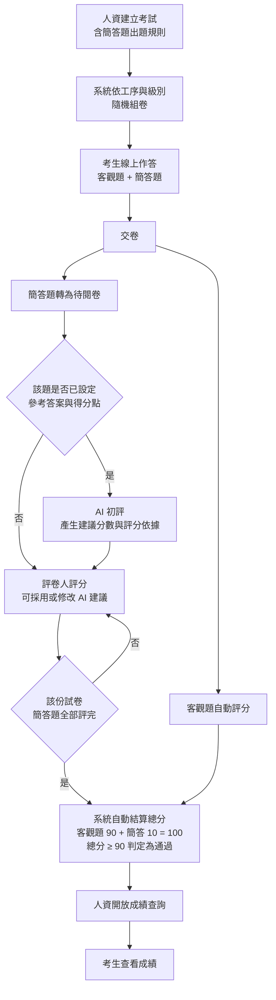
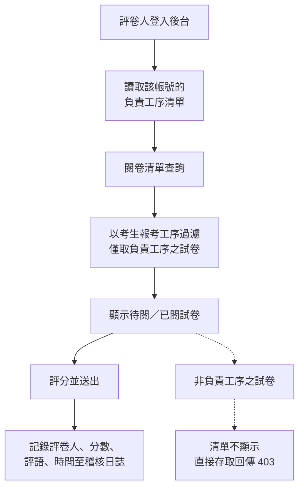
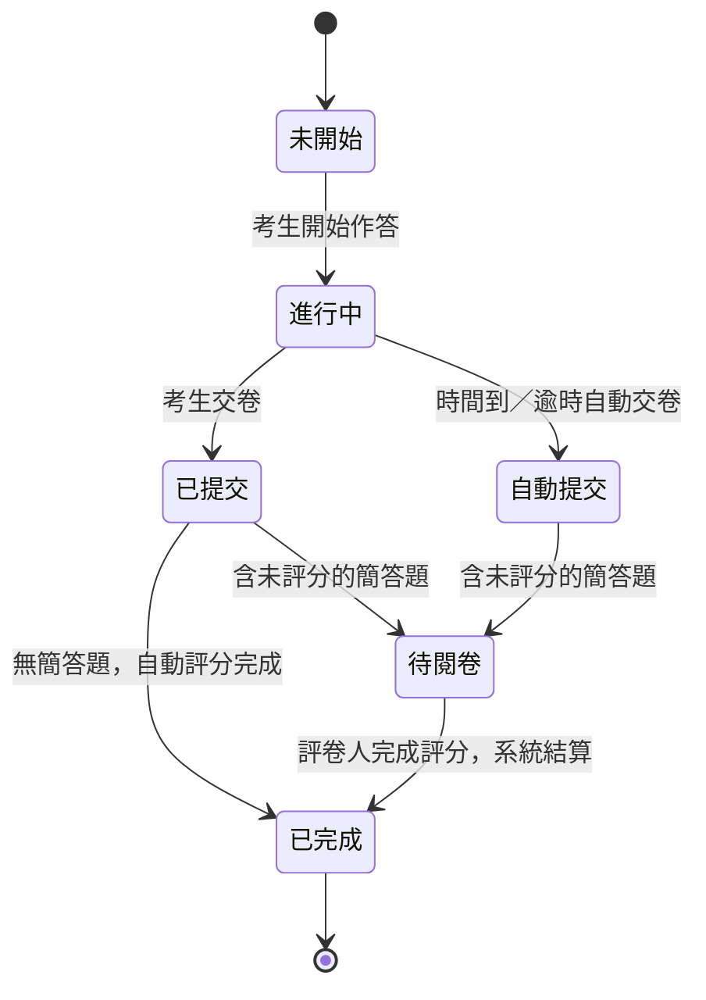

# PRD — 簡答題線上化與分工序閱卷

**產品**：智考雲線上考核平台
**文件版本**：v0.1（草案）
**日期**：2026-10-15
**狀態**：草案，待確認事項回覆後凍結
**關聯文件**：《需求訪談紀錄 — 簡答題線上化與分工序閱卷》

### 修訂紀錄

| 版本 | 日期 | 修訂內容 | 修訂人 |
|---|---|---|---|
| v0.1 | 2026-10-15 | 初版草案，涵蓋簡答題線上化、分工序閱卷、AI 輔助評分 | — |

### 名詞定義

| 名詞 | 說明 |
|---|---|
| 工序 | 考生報考的作業工序，如 SAW、DB、WB、DW、MD、TF、TMTT、Plating、IQC 等 |
| 級別 | 技能考核等級，Ⅰ级／Ⅱ级 |
| 題目範圍 | 本次全數抽自考生所報考之工序題庫，本工序題目占比 100%（不另抽不分工序之基本題） |
| 評卷人 | 負責線上批改簡答題的後台帳號角色，對應各工序評卷負責人 |
| 理論成績 | 本次考核成績即線上理論總分（100 分制），理論成績占比 100%，不含實操加權 |

### 角色

| 角色 | 說明 |
|---|---|
| 系統管理員 | 全系統權限，負責後台帳號管理 |
| 人資（HR） | 題庫、考試、員工與成績管理 |
| 評卷人 | 僅批改所負責工序的簡答題 |
| 考生 | 線上作答與成績查詢 |

---

## 1. 背景與目標

現行平台的線上考試僅包含客觀題（單選／多選／判斷），交卷後全自動評分；簡答題（10 分）過去採線下紙本作業。**本次考核無實操紙本題目，亦無須匯入實操成績**，考核成績即線上理論總分（100 分制）。

客戶提出三項需求：
1. 簡答題改為線上作答，並可按工序隨機分配題目；
2. 開設多個評卷人帳號，分派至各工序評卷負責人，且僅能看到本工序考生的試卷；
3. 評估簡答題以 AI 判定的正確率；若準確率不足，則僅使用系統線上答題、由負責人手工評分。

**目標**：將簡答題納入線上考核流程，建立以工序為單位的閱卷權責分工，使考核全流程線上化、可追溯，並縮短成績產出時程。

**成功指標**
- 簡答題紙本作業歸零（免印卷、收卷、謄分）。
- 閱卷由單人序列作業改為各工序並行，閱卷時程縮短。
- 每筆評分可追溯至評卷人，成績爭議可稽核。

---

## 2. 範圍

**本次納入**
- 簡答題線上作答，依工序／級別隨機抽題
- 簡答題線上人工評分，成績自動併入總分
- 評卷人帳號管理與工序權限隔離
- AI 輔助評分：AI 產生建議分數供評卷人參考，評卷人可檢視與修改，最終分數由人工確認
- 計分規則明確化：客觀題 90 分＋簡答題 10 分＝100 分，理論成績占比 100%
- 考試過程控制調整：切屏達上限是否強制交卷改為可開關，關閉時僅提醒與記錄，由人資人工判定
- 成績查詢與錯題解析之開放時間設定（既有功能，納入本次設定與驗收）

**本次不納入**
- 實操考核與實操成績匯入（本次無實操紙本題目）
- 既有客觀題出題、防作弊監控、成績查詢機制維持現狀
- 題庫參考答案與評分要點之內容撰寫（由客戶提供）

---

## 3. 功能需求

### F1 簡答題線上作答（按工序隨機出題）

> **使用者故事**：身為考生，我希望在線上直接作答簡答題，不必再寫紙本考卷。
> 身為人資，我希望簡答題能依考生工序自動抽題，不必為每個工序人工出卷。

| 編號 | 需求 | 說明 | 優先級 |
|---|---|---|---|
| F1-1 | 出題規則支援簡答題 | 建立／編輯考試時可加入簡答題規則，設定題數與每題配分（預設 1 題 10 分） | P0 |
| F1-2 | 按工序隨機抽題 | 依考生「部門＋工序＋級別」自題庫隨機抽取簡答題，沿用現行客觀題抽題邏輯；本次全部抽自本工序題庫（占比 100%） | P0 |
| F1-3 | 線上作答 | 考生以文字輸入答案（上限 2000 字），支援自動存稿、題目標記、倒數計時與防作弊監控 | P0 |
| F1-4 | 交卷流程 | 交卷後客觀題即時自動評分；含簡答題之試卷轉為「待閱卷」，考生端顯示成績待公佈 | P0 |
| F1-5 | 配分正確性 | 閱卷給分上限以考試設定之配分為準，支援單題 10 分 | P0 |
| F1-6 | 即時出分 | 交卷後客觀題即時自動評分並顯示得分、正確率與作答用時；簡答題未評分前，總分顯示為待評分狀態 | P0 |
| F1-7 | 分數更新 | 簡答題人工評分完成後，系統自動重算總分與及格判定，考生端同步更新 | P0 |
| F1-8 | 計分規則 | 依「計分方式與分數顯示」一節計算，理論成績占比 100%；簡答題批改完成後才判定是否合格 | P0 |

**業務規則**
- 題庫中簡答題數量不足之工序，沿用現行補題機制並於後台提示警告。
- 考生未作答之簡答題以 0 分計，不進入待閱清單。

### F2 多評卷人帳號與工序權限隔離

> **使用者故事**：身為工序評卷負責人，我希望登入後只看到自己工序考生的試卷，專心批改我看得懂的題目。
> 身為人資，我希望評分責任明確到人，發生成績爭議時可以追查。

| 編號 | 需求 | 說明 | 優先級 |
|---|---|---|---|
| F2-1 | 帳號管理 | 人資可於後台自行新增、停用評卷人帳號並重設密碼，無須我方介入 | P0 |
| F2-2 | 工序指派 | 人資可於後台將帳號指派至一個或多個負責工序，並可隨時調整 | P0 |
| F2-3 | 資料隔離 | 評卷人僅能查詢與批改所屬工序考生之試卷，其他工序不可見且不可直接存取 | P0 |
| F2-4 | 功能限制 | 評卷人僅開放閱卷相關頁面；員工管理、題庫管理、成績匯出、監考等不開放 | P0 |
| F2-5 | 評分留痕 | 每筆評分記錄評卷人、分數、評語與時間，寫入稽核日誌 | P0 |
| F2-6 | 閱卷進度 | 管理員可檢視各工序之閱卷進度（待閱／已閱份數） | P0 |
| F2-7 | 共用帳號 | 支援以工序為單位建立共用帳號，由該工序人員共用帳密登入評卷 | P0 |
| F2-8 | AD 整合 | 以客戶 AD 帳號登入後台，依 AD 群組或後台設定對應負責工序；需 IT 提供 LDAP／LDAPS 連線與帳號對應規則 | P0 |
| F2-9 | 盲評 | 閱卷畫面可隱藏考生姓名與工號，僅顯示編號 | P2 |

**權限矩陣**

| 功能 | 系統管理員 | 人資 | 評卷人 |
|---|---|---|---|
| 後台帳號管理 | ✅ | — | — |
| 題庫／考試／員工管理 | ✅ | ✅ | — |
| 閱卷（全工序） | ✅ | ✅ | — |
| 閱卷（限指派工序） | — | — | ✅ |
| 成績查詢／匯出 | ✅ | ✅ | — |
| 監考與稽核紀錄 | ✅ | ✅ | — |

**帳號來源（三擇一或併行）**

| 方式 | 說明 | 適用情境 |
|---|---|---|
| 系統自建個人帳號（預設） | 人資於後台建立個別評卷人帳號並指派工序 | 需明確追溯評分責任至個人 |
| 工序共用帳號 | 以工序為單位建立一組帳密，該工序人員共用 | 評卷人員異動頻繁、不需追溯至個人；稽核僅能追溯至工序 |
| AD 整合 | 以客戶既有 AD 帳號登入，工序對應於後台設定 | 統一帳號管理，免除另行建帳號與發放密碼 |

> 三種方式均納入本次交付，可併行使用；工序與評卷人之對應一律由人資於後台自行分配與調整，不需客戶事先提供完整名單。
> AD 整合需客戶 IT 提供網域控制站位址、LDAP／LDAPS 連線權限、查詢帳號與帳號對應規則（見第 8 節）。

### F3 簡答題 AI 輔助評分

> **使用者故事**：身為評卷人，我希望系統先給出建議分數與評分依據，我只需確認或微調，減少逐份細讀的時間。

**定位**：AI 評分結果僅作為**參考**，不自動成為最終成績；評卷人必須能檢視 AI 的建議分數與依據，並可自行修改，最終分數一律由評卷人確認送出。

| 編號 | 需求 | 說明 | 優先級 |
|---|---|---|---|
| F3-1 | 題庫欄位 | 題庫支援「參考答案」與「評分要點（得分點）」之維護與 Excel 匯入；簡答題之「正确答案」欄位應對應至參考答案欄 | P0 |
| F3-2 | AI 初評 | 依題目之參考答案與得分點，產生建議分數、評分依據與信心度 | P0 |
| F3-3 | 人工檢視與修改 | 閱卷畫面顯示 AI 建議分數與評分依據，評卷人可一鍵採用或自行修改分數與評語 | P0 |
| F3-4 | 分數來源標示 | 記錄該筆分數為「採用 AI 建議」或「人工修改」，並保留 AI 原始建議值 | P0 |
| F3-5 | 準確率實測 | 比對 AI 建議分數與評卷人最終分數，產出一致率與平均誤差報告 | P0 |
| F3-6 | 降級機制 | 題目未設定參考答案或 AI 服務異常時，閱卷流程不受影響，直接進入人工評分 | P0 |

**業務規則**
- AI 建議分數在評卷人未確認前，不計入成績、不觸發成績結算。
- 無論是否採用 AI 建議，稽核日誌一律記錄實際送出分數之評卷人。

**前提與限制**
- 參考答案現況：客戶新提供之題庫（部门专业知识90%，37 個檔案）含簡答題 480 題，其中 **467 題（97%）已填寫參考答案**，且多已拆為條列式得分點；僅「资材部仓管Ⅰ级／Ⅱ级」共 13 題未填。
- 系統內既有之 470 題簡答題中，386 題的答案存於「正確答案」欄位而非「參考答案」欄位，致閱卷畫面無法顯示；須於匯入與欄位對應一併修正（F3-1）。
- 題目未附參考答案時，AI 建議分數之參考價值極低，系統將標示低信心度或不顯示建議，由評卷人全人工評分。
- 我方不對 AI 判分之準確率提供數值承諾；實際準確率以 F3-5 之實測報告為準。

### 計分方式與分數顯示（共通規則）

**題型與配分（本次考試）**

| 題型 | 題數 | 每題配分 | 小計 | 評分方式 |
|---|---|---|---|---|
| 單選題 | 20 | 2 | 40 | 系統自動評分 |
| 判斷題 | 10 | 1 | 10 | 系統自動評分 |
| 多選題 | 20 | 2 | 40 | 系統自動評分，選錯或漏選不得分 |
| 簡答題 | 1 | 10 | 10 | 評卷人評分（可參考 AI 建議分數） |
| **合計** | **51** | — | **100** | — |

> 題數與配分於後台出題規則逐條設定，總分由系統自動累加，可隨考試調整。
> 本次全部題目（含簡答題）均抽自考生所報考之工序題庫，本工序題目占比 100%，不另抽不分工序之基本題。

**計分公式**

```
客觀題得分 = Σ（各客觀題得分）                    ← 交卷後即時產生，本次滿分 90
簡答題得分 = 評卷人送出之分數                      ← 本次滿分 10
線上理論總分 = 客觀題得分 + 簡答題得分              ← 本次滿分 100
是否及格 = 線上理論總分 ≥ 後台設定之及格分（本次設定為 90 分）
正確率 = 答對題數 ÷ 總題數（簡答題以得分 > 0 視為答對）
```

**及格判定規則**

- 理論通過規則：**線上理論總分 ≥ 90 分**（及格分於後台設定，本次設為 90）。
- **須待簡答題批改完成後才判定是否合格**；簡答題未評分前，系統不產生及格／不及格結果，考生端顯示為待評分狀態。
- 本次考核成績即線上理論總分，理論成績占比 100%，不計算實操加權之綜合成績。

**分數顯示時點**

| 時點 | 考生端看到的內容 |
|---|---|
| 交卷當下 | 客觀題得分、正確率、作答用時；總分標示為「簡答題待評分」 |
| 簡答題評分完成 | 總分（客觀題＋簡答題）與及格判定自動更新（總分 ≥ 90 為通過） |
| 人資開放查詢後 | 錯題解析、正確答案與個人考試報告 |

---

### F4 考試過程控制

> **使用者故事**：身為考生，我在手機上考試時螢幕自動熄屏或被來電打斷，不應該因此被強制交卷。
> 身為人資，我仍希望知道哪些考生在考試中離開畫面、離開幾次，以便事後判定。

**技術限制（須先知悉）**：本次採手機瀏覽器作答。瀏覽器僅能得知頁面「進入背景（hidden）」，**無法區分螢幕熄屏／鎖屏、來電，與切換至其他 App**，三者訊號完全相同。因此不以技術手段判斷黑屏，改以「是否強制交卷」之開關與事後人工判定處理。

| 編號 | 需求 | 說明 | 優先級 |
|---|---|---|---|
| F4-1 | 離開畫面計次與提醒 | 頁面進入背景時記錄一次並寫入稽核日誌，返回後以提示訊息提醒考生 | P0 |
| F4-2 | 強制交卷開關 | 後台可設定「離開畫面達上限是否強制交卷」。**關閉時（本次預設）**：不交卷、不中斷作答，僅提醒與記錄，由人資依稽核紀錄人工判定；**開啟時**：達上限後倒數並強制交卷 | P0 |
| F4-3 | 門檻可設定 | 提醒／強制交卷之次數門檻由後台考試設定決定（現行前端寫死 3 次，須改為讀取設定值） | P0 |
| F4-4 | 異常紀錄呈現 | 後台監考與成績頁可查看各考生之離開畫面次數與時間，並可隨成績一併匯出 | P0 |
| F4-5 | 時間到自動交卷 | 作答時間結束時系統自動交卷，依實際作答結果計分，**不得顯示滿分或未經評分之分數** | P0 |
| F4-6 | 斷網保護 | 斷線時作答內容保留於本機並於恢復後續傳，不因斷線判定為離開畫面 | P0 |

### F5 成績查詢與錯題解析開放設定

> 本節功能系統已具備，本次納入設定與驗收範圍，確保實際啟用。

| 編號 | 需求 | 說明 | 優先級 |
|---|---|---|---|
| F5-1 | 開放期間設定 | 人資可設定成績查詢之開放起訖時間，期間外考生無法查看成績明細 | P0 |
| F5-2 | 錯題解析 | 開放期間內，考生可查看各題作答、正確答案與解析 | P0 |
| F5-3 | 個人考試報告 | 顯示得分、正確率、作答用時；是否顯示正確答案由後台開關控制 | P0 |
| F5-4 | 手機端呈現 | 上述內容於手機瀏覽器可正常檢視 | P0 |

---

## 4. 主要流程

### 4.1 整體作業流程



### 4.2 分工序閱卷權限流程



### 4.3 試卷狀態流轉



---

## 5. 系統異動概要

| 項目 | 異動內容 |
|---|---|
| 出題設定 | 開放簡答題為可選題型 |
| 評分上限 | 閱卷給分上限改以考試設定之配分為準（現行以題庫預設配分為上限） |
| 資料模型 | 新增「評卷人 ↔ 負責工序」對應關係；題庫啟用參考答案／評分要點欄位 |
| 權限控管 | 後台頁面與 API 新增角色及工序範圍檢查 |
| 成績口徑 | 簡答題分數來源由「線下匯入」改為「線上評分」；本次不匯入實操成績，考核成績即線上理論總分（100 分制） |
| 基礎資料 | 工序名稱標準化（現有資料含人名與合併工序，需先清理） |
| AI 評分 | 介接 AI 服務產生建議分數；閱卷畫面新增建議分數、評分依據與採用／修改之紀錄 |
| 題庫匯入 | 修正簡答題欄位對應（「正确答案」→ 參考答案），並重新匯入客戶新提供之題庫 |
| 帳號登入 | 新增帳號管理與工序指派介面；新增 AD／LDAP 認證模組與共用帳號機制 |
| 考試過程控制 | 新增「離開畫面達上限是否強制交卷」開關；前端改為讀取後台之次數門檻（現行寫死 3 次） |
| 成績呈現 | 交卷後即時顯示客觀題得分；簡答題評分完成後自動更新總分與及格判定 |

---

## 6. 非功能需求

| 項目 | 需求 |
|---|---|
| 安全性 | 權限檢查於後端 API 執行，不僅隱藏前端選單；越權存取回傳 403 |
| 稽核 | 帳號異動與每筆評分皆寫入稽核日誌，可查詢 |
| 效能 | 閱卷清單在單場數百份試卷下，載入時間 3 秒內 |
| 相容性 | 支援現行 PC 瀏覽器與行動端 App，簡答題輸入須可於手機正常作答 |
| 相容性（資料） | 既有考試與成績資料不受影響，權限調整不影響歷史紀錄 |

---

## 7. 驗收標準

1. 考試可設定簡答題；考生依工序抽到對應工序之簡答題，10 分可正常給分。
2. 評卷人 A（負責工序 X）登入後僅顯示工序 X 之試卷；以網址直接存取其他工序資料時被拒絕。
3. 評卷人無法進入員工管理、題庫管理、成績匯出等頁面。
4. 簡答題評分完成後，系統自動結算總分並依「總分 ≥ 90」判定是否通過；評分完成前不產生及格結果。
5. 每筆評分可查得評卷人、分數、評語與時間。
6. 評卷人可使用 AD 帳號登入後台，並正確對應至其負責工序；AD 服務異常時，系統自建帳號仍可登入。
7. 閱卷畫面可顯示 AI 建議分數與評分依據，評卷人可採用或修改，最終分數以評卷人送出者為準。
8. 題目未設定參考答案或 AI 服務異常時，閱卷流程仍可正常進行人工評分。
9. 可產出 AI 建議分數與評卷人最終分數之一致率、平均誤差比對報告。
10. 考試可設定為單選 20×2、判斷 10×1、多選 20×2、簡答 1×10，總分自動累加為 100 分。
11. 交卷後立即顯示客觀題得分、正確率與用時；簡答題評分完成後總分自動更新。
12. 「強制交卷開關」關閉時，考生離開畫面達門檻不會被強制交卷，僅出現提醒，且稽核日誌完整記錄次數與時間。
13. 時間到自動交卷後，顯示之分數為實際作答結果，不出現滿分或未評分之分數。
14. 成績查詢開放期間外無法查看錯題解析；開放後可於手機瀏覽器正常檢視解析與個人報告。

---

## 8. 前置條件與風險

| 項目 | 說明 | 負責方 |
|---|---|---|
| AD 整合連線資訊（關鍵） | 網域控制站位址、LDAP／LDAPS 連線權限與查詢帳號、AD 帳號與評卷人之對應規則（以 AD 群組或後台手動指派）；考試主機須能連通網域控制站 | 客戶 IT 提供 |
| 工序與評卷人對應 | 由人資於後台自行分配與調整，不需事先提供完整名單 | 人資操作 |
| 參考答案 | 新題庫 480 題中 467 題已具參考答案；僅「资材部仓管Ⅰ级／Ⅱ级」13 題待補 | 客戶補齊 |
| 考試時長 | 題型配分與及格分已確認（90＋10＝100、及格 90 分）；作答時間是否自 60 分鐘調整，於後台可自行設定 | 客戶確認 |
| 工序基礎資料 | 工序目前為自由文字、無主檔，另有少數填寫異常之資料，將影響權限歸屬 | 我方彙整後送人資確認 |
| 成績口徑 | 簡答題分數改以線上評分為準，線下匯入之「簡答分」欄位停用；本次不計實操加權，理論成績占比 100% | 我方逕行處理 |
| AI 準確率認知 | 我方不提供準確率數值承諾；AI 僅為參考分數，最終成績由評卷人確認，不影響成績正確性 | 雙方確認 |
| 評分一致性 | 不同考生抽到不同題目、由不同人評分，建議同工序同級別提供統一評分要點 | 雙方確認 |

---

## 9. 交付範圍

| 項次 | 交付內容 |
|---|---|
| 1 | F1 簡答題線上作答與按工序隨機出題 |
| 2 | F2 評卷人帳號管理與工序權限隔離 |
| 3 | AD 整合登入與工序共用帳號 |
| 4 | F3 AI 輔助評分（建議分數＋人工確認） |
| 5 | 考試過程控制調整（強制交卷開關、門檻可設定）與成績查詢開放設定 |
| 6 | 工序基礎資料標準化整理 |
| 7 | 第一次考試後之 AI 與人工評分一致率比對報告（F3-5） |

> 三項需求均納入第一階段一次交付。AI 僅提供參考分數、不自動計入成績，故不構成上線風險；惟題庫參考答案之補齊為 AI 建議分數能否發揮效用之前提，請依第 8 節配合提供。

---

## 10. 待確認事項

需客戶提供或確認者共 3 項（評卷人名單與負責工序、簡答題參考答案與評分要點、簡答題題數與考試時間），其餘實作細節由我方逕行規劃；詳見《需求訪談紀錄 — 簡答題線上化與分工序閱卷》第 5、6 節。

---

## 附錄 A：本次考試設定值

> 供人資於後台建立考試時對照填入；數值如有調整以客戶最終確認為準。

| 設定項目 | 本次設定值 |
|---|---|
| 考試標題 | 强茂半导体 2026 年度半年度技能考试 |
| 副標題／說明 | 手机端在线理论考试 |
| 題型與配分 | 單選 20 題×2 分、判斷 10 題×1 分、多選 20 題×2 分、簡答 1 題×10 分 |
| 總分 | 100 分 |
| 及格分 | 90 分（理論通過規則：總分 ≥ 90） |
| 考試時長 | 依客戶確認（現行預設 60 分鐘，後台可調整） |
| 題目範圍 | 本工序題目占比 100%（基本題比例設為 0%） |
| 離開畫面提醒門檻 | 3 次（後台可調整） |
| 達門檻是否強制交卷 | 否（僅提醒與記錄，由人資人工判定） |
| 時間到處理 | 自動交卷，依實際作答結果計分 |
| 綜合成績 | 不適用，本次無實操考核，成績即線上理論總分 |
| 成績查詢開放期間 | 考試後由人資手動設定起訖時間 |
| 錯題解析／正確答案 | 開放期間內顯示 |
| 登入方式 | 考生：姓名＋工號＋部門＋身分證後 6 碼 |
