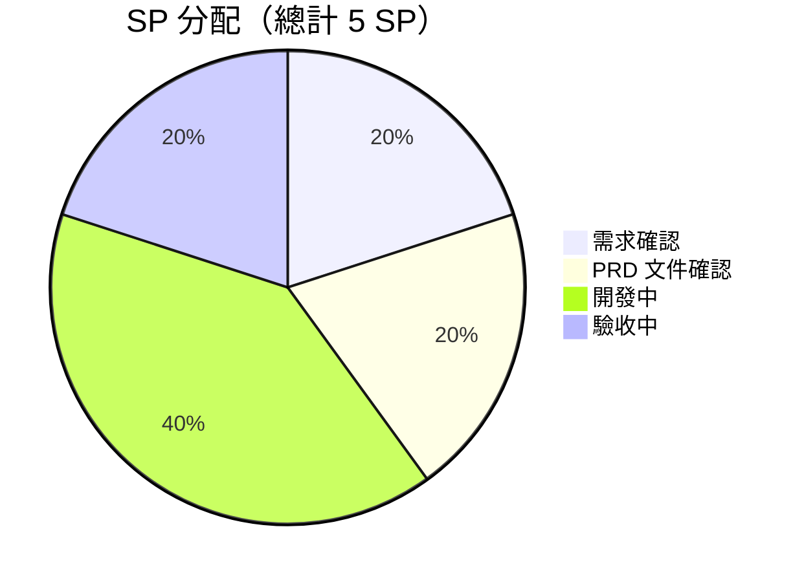

# 智考雲 — 簡答題線上化與分工序閱卷（Story Points）

**文件版本：** 1.0
**製作日期：** 2026-10-15
**專案名稱：** 智考雲線上考核平台 — 2026 半年度技能考試需求增補
**關聯文件：**《PRD — 簡答題線上化與分工序閱卷》、《需求訪談紀錄 — 簡答題線上化與分工序閱卷》

---

## 📋 需求概述

本次為既有線上考核平台之功能增補，針對「强茂半導體 2026 年度半年度技能考試」之作業需求，將簡答題納入線上流程，並建立以工序為單位的閱卷權責分工。

### 核心價值
- **全線上化**：簡答題由紙本改為線上作答與線上評分，免除印卷、收卷、謄分
- **權責分工**：各工序評卷負責人並行閱卷，僅能看到本工序考生試卷，責任到人、全程留痕
- **AI 輔助**：AI 產生建議分數供評卷人參考，評卷人可檢視與修改，最終以人工確認為準
- **彈性管控**：離開畫面是否強制交卷改為可開關，符合「黑屏不自動交卷」之管理要求

### 本次成績結構
單選 20×2 ＋ 判斷 10×1 ＋ 多選 20×2 ＝ 90 分（自動評分、立即出分）
＋ 簡答 1×10 分（線上作答、人工評分）＝ **總分 100 分**，理論成績占比 100%，通過門檻 **≥ 90 分**

---

## 📊 專案規模總覽

### 整體 Story Points 分配

### 專案指標

| 專案指標 | SP |
|---|---:|
| 需求確認 | 1 |
| PRD 文件確認 | 1 |
| 開發中 | 2 |
| 驗收中 | 1 |
| **合計** | **5 SP** |

### SP 階段說明

| 階段 | SP | 範圍 | 說明 |
|------|---:|------|------|
| 需求確認 | 1 | 需求訪談、現況盤點、可行性評估 | 釐清三項需求與客戶 IT 補充之七項事項；盤點既有系統（題庫、抽題、閱卷、權限、防作弊）現況與落差；確認 AI 判分之前提條件 |
| PRD 文件確認 | 1 | PRD 撰寫、客戶審閱與修訂 | 產出 PRD 與需求訪談紀錄；依客戶紅字修訂（級別、題目範圍 100%、理論成績 100%、及格門檻 90、無實操匯入）調整並定稿 |
| 開發中 | 2 | 功能開發與整合 | 簡答題線上化、評卷人帳號與工序權限隔離（含共用帳號與 AD 整合）、AI 輔助評分、考試過程控制調整、題庫欄位對應修正與重新匯入 |
| 驗收中 | 1 | 功能驗收與上線準備 | 權限隔離測試、計分與及格判定驗證、自動交卷顯示查核、手機瀏覽器相容性、客戶 UAT 與上線協助 |

---

## 🗂️ 功能模組清單

> 狀態說明：🆕 新增開發｜⚙️ 既有功能調整｜✅ 既有功能（僅需設定與驗收）

### 模組 1：簡答題線上作答（PRD F1）

| 功能 | 狀態 | 說明 |
|------|------|------|
| 出題規則支援簡答題 | ⚙️ 調整 | 開放簡答題為可選題型（現行設定排除） |
| 按工序隨機抽題 | ✅ 既有 | 依部門＋工序＋級別抽題，本次本工序題目占比 100% |
| 線上文字作答 | ✅ 既有 | 上限 2000 字，自動存稿、題目標記、倒數計時 |
| 交卷流程 | ✅ 既有 | 客觀題即時評分，含簡答題之試卷轉「待閱卷」 |
| 配分正確性 | 🆕 新增 | 閱卷給分上限改以考試設定之配分為準，支援單題 10 分 |
| 即時出分與分數更新 | ⚙️ 調整 | 交卷顯示客觀題得分、正確率、用時；簡答評完自動重算總分與及格判定 |

### 模組 2：評卷人帳號與工序權限隔離（PRD F2）

| 功能 | 狀態 | 說明 |
|------|------|------|
| 帳號管理介面 | 🆕 新增 | 人資可自行新增、停用帳號與重設密碼 |
| 工序指派 | 🆕 新增 | 帳號可指派一個或多個負責工序，可隨時調整 |
| 資料隔離 | 🆕 新增 | 閱卷清單僅顯示所屬工序試卷，越權存取回傳 403 |
| 角色權限控管 | 🆕 新增 | 後台頁面與 API 新增角色及工序範圍檢查 |
| 工序共用帳號 | 🆕 新增 | 以工序為單位建立共用帳密 |
| AD 整合登入 | 🆕 新增 | LDAP／LDAPS 認證模組，AD 帳號對應負責工序 |
| 評分留痕 | ⚙️ 調整 | 記錄評卷人、分數、評語、時間與分數來源（AI 建議／人工修改） |
| 閱卷進度 | 🆕 新增 | 各工序待閱／已閱份數統計 |

### 模組 3：AI 輔助評分（PRD F3）

| 功能 | 狀態 | 說明 |
|------|------|------|
| 題庫參考答案欄位 | ⚙️ 調整 | 簡答題「正确答案」欄位對應至參考答案欄；支援評分要點維護與匯入 |
| AI 初評 | 🆕 新增 | 產生建議分數、評分依據與信心度 |
| 人工檢視與修改 | 🆕 新增 | 閱卷畫面預填建議分數，可一鍵採用或自行修改 |
| 分數來源標示 | 🆕 新增 | 保留 AI 原始建議值，標示採用或修改 |
| 降級機制 | 🆕 新增 | 無參考答案或 AI 異常時自動轉全人工評分 |
| 準確率實測報告 | 🆕 新增 | 比對 AI 建議與評卷人最終分數之一致率與平均誤差 |

### 模組 4：考試過程控制（PRD F4）

| 功能 | 狀態 | 說明 |
|------|------|------|
| 離開畫面計次與提醒 | ✅ 既有 | 進入背景即記錄並提醒 |
| 強制交卷開關 | 🆕 新增 | 後台可設定達門檻是否強制交卷，本次預設關閉 |
| 門檻讀取後台設定 | ⚙️ 調整 | 現行前端寫死 3 次，改為讀取考試設定值 |
| 異常紀錄呈現 | ⚙️ 調整 | 監考與成績頁顯示離開次數，可隨成績匯出 |
| 時間到自動交卷 | ✅ 既有 | 依實際作答結果計分，不顯示滿分 |

### 模組 5：成績查詢與錯題解析（PRD F5）

| 功能 | 狀態 | 說明 |
|------|------|------|
| 開放期間設定 | ✅ 既有 | 人資設定查詢開放起訖時間 |
| 錯題解析與正確答案 | ✅ 既有 | 開放期間內可查看各題作答與正確答案 |
| 個人考試報告 | ✅ 既有 | 得分、正確率、作答用時 |
| 手機端呈現 | ✅ 既有 | 手機瀏覽器正常檢視 |

### 模組 6：基礎資料整理

| 功能 | 狀態 | 說明 |
|------|------|------|
| 工序名稱標準化 | 🆕 新增 | 彙整標準工序清單，處理合併工序與異常值 |
| 題庫重新匯入 | ⚙️ 調整 | 匯入客戶新提供之題庫（37 檔、簡答題 480 題），修正欄位對應 |

---

## 📦 交付物清單

### 系統交付物

🆕 **簡答題線上考試能力**
- 出題規則支援簡答題、單題 10 分配分正確
- 線上作答、待閱卷流程、即時出分與評分後總分更新

🆕 **評卷人權限體系**
- 帳號管理與工序指派介面
- 工序資料隔離與角色權限控管
- 工序共用帳號、AD／LDAP 整合登入
- 各工序閱卷進度與評分稽核紀錄

🆕 **AI 輔助評分**
- AI 建議分數、評分依據與信心度
- 閱卷畫面預填與一鍵採用／修改
- 分數來源標示與降級機制

⚙️ **考試過程控制調整**
- 強制交卷開關（本次關閉）與門檻可設定
- 離開畫面異常紀錄呈現與匯出

✅ **成績查詢設定**
- 錯題解析、正確答案與個人報告之開放期間設定與驗收

### 文件交付物

✅ **PRD 產品需求文件** — 《PRD — 簡答題線上化與分工序閱卷》v0.1
✅ **需求訪談紀錄** — 需求原話、現況盤點、待確認事項與後續行動
✅ **SP 規劃書** — 本文件
🆕 **AI 評分準確率比對報告** — 第一次考試後產出
🆕 **題庫匯入結果報表** — 匯入筆數、工序分布與異常清單

---

## ✅ 驗收標準

### 1. 簡答題線上化
- [ ] 考試可設定單選 20×2、判斷 10×1、多選 20×2、簡答 1×10，總分自動累加為 100 分
- [ ] 考生依工序與級別抽到對應工序之簡答題（本工序題目占比 100%）
- [ ] 簡答題可線上輸入作答並自動存稿
- [ ] 閱卷可給至 10 分，不被題庫預設配分截斷
- [ ] 交卷後立即顯示客觀題得分、正確率與作答用時
- [ ] 簡答題評分完成後總分自動更新，並依「總分 ≥ 90」判定是否通過
- [ ] 簡答題評分完成前不產生及格／不及格結果

### 2. 評卷人權限隔離
- [ ] 人資可於後台自行新增、停用評卷人帳號並重設密碼
- [ ] 帳號可指派一個或多個工序並可調整
- [ ] 評卷人登入後僅顯示所屬工序試卷
- [ ] 以網址直接存取其他工序資料時被拒絕（403）
- [ ] 評卷人無法進入員工管理、題庫管理、成績匯出等頁面
- [ ] 工序共用帳號可正常登入並受同一工序範圍限制
- [ ] 可使用 AD 帳號登入並正確對應負責工序
- [ ] AD 服務異常時，系統自建帳號仍可登入
- [ ] 每筆評分可查得評卷人、分數、評語與時間
- [ ] 管理員可檢視各工序閱卷進度

### 3. AI 輔助評分
- [ ] 閱卷畫面顯示 AI 建議分數與評分依據
- [ ] 評卷人可一鍵採用或自行修改分數與評語
- [ ] AI 建議在評卷人確認前不計入成績、不觸發結算
- [ ] 系統保留 AI 原始建議值並標示分數來源
- [ ] 題目無參考答案或 AI 異常時，閱卷流程仍可正常進行
- [ ] 可產出 AI 與人工評分之一致率、平均誤差報告

### 4. 考試過程控制
- [ ] 強制交卷開關關閉時，離開畫面達門檻不會被強制交卷，僅出現提醒
- [ ] 離開畫面次數與時間完整記錄於稽核日誌，並可於後台查看與匯出
- [ ] 提醒／強制交卷門檻讀取後台考試設定值
- [ ] 時間到自動交卷後顯示實際得分，不出現滿分或未評分之分數
- [ ] 斷線恢復後作答內容完整，不誤判為離開畫面

### 5. 成績查詢與錯題解析
- [ ] 開放期間外無法查看成績明細與錯題解析
- [ ] 開放期間內可查看各題作答、正確答案與個人考試報告
- [ ] 上述內容於手機瀏覽器可正常檢視

### 6. 資料與相容性
- [ ] 新題庫匯入成功，簡答題參考答案正確寫入並於閱卷畫面顯示
- [ ] 工序名稱標準化完成，無無法歸屬之試卷
- [ ] 手機瀏覽器（iOS / Android）作答與查分流程順暢
- [ ] 既有考試與歷史成績不受影響

---

## 🚫 明確排除項目

| 排除項目 | 原因 |
|----------|------|
| 實操考核與實操成績匯入 | 本次無實操紙本題目，無須匯入系統 |
| 綜合成績（理論／實操加權） | 本次理論成績占比 100%，不計加權 |
| 題庫參考答案內容撰寫 | 由客戶提供，我方僅負責匯入與欄位對應 |
| 以技術手段區分黑屏與切換 App | 手機瀏覽器無此能力，改以強制交卷開關與人工判定處理 |
| AI 自動定分 | AI 僅提供建議分數，最終分數一律由評卷人確認 |

---

## 🎯 成功標準

✅ **流程線上化**：簡答題紙本作業歸零（免印卷、收卷、謄分）
✅ **閱卷效率**：各工序並行閱卷，成績產出時程較紙本作業縮短
✅ **權責明確**：每筆評分可追溯至評卷人（共用帳號則可追溯至工序）
✅ **計分正確**：總分 100 分制計算正確，及格判定於簡答題批改後產生
✅ **作答體驗**：黑屏／鎖屏不再導致強制交卷，考生申訴案件歸零
✅ **AI 可用性**：以實測報告呈現 AI 建議分數之一致率，作為後續採用依據

---

## ⚠️ 前置依賴（影響時程）

| # | 項目 | 負責方 |
|---|------|--------|
| 1 | AD 連線資訊與帳號對應規則，並開通考試主機至網域控制站之連線 | 客戶 IT |
| 2 | 補齊「资材部仓管Ⅰ级／Ⅱ级」13 題簡答題參考答案 | 客戶 |
| 3 | 確認作答時間是否自 60 分鐘調整 | 客戶 |
| 4 | 標準工序清單與異常資料確認 | 客戶人資（我方彙整後送審） |

> AD 整合為本次唯一對外系統整合，且需等待客戶 IT 開通連線，為時程上最主要的外部相依項目。
